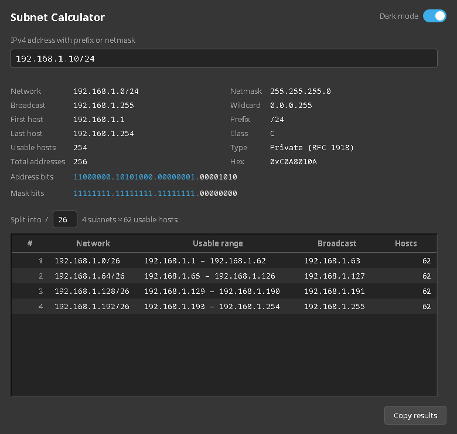
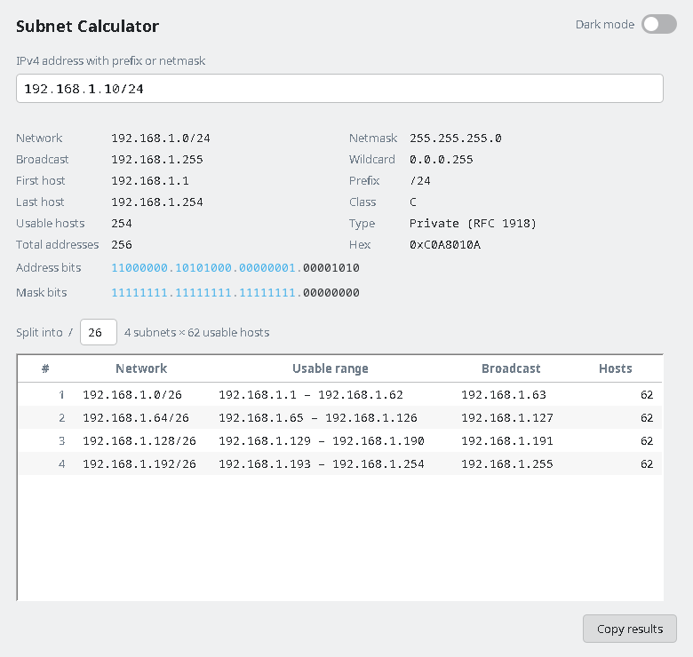

# Subnet Calculator

A fast IPv4 subnet calculator for the Linux desktop, written in plain Java with **no dependencies**.
It reads your KDE colour scheme and accent colour so it looks at home on Plasma (Breeze), and has a
dark / light mode switch.

| Dark | Light |
|---|---|
|  |  |

## Features

- Accepts `192.168.1.10/24`, `192.168.1.10/255.255.255.0`, `192.168.1.10 255.255.255.0` or a bare
  address (classful default prefix). Results update as you type.
- Network, broadcast, first/last host, usable and total addresses, netmask, wildcard, class,
  address type (private, CGNAT, loopback, multicast…) and hex.
- Address and mask shown in binary with the network bits highlighted.
- Splits a network into smaller subnets. Rows are computed on demand, so large splits use no memory.
- Handles /31 point-to-point links (RFC 3021) and /32 host routes correctly.
- **Copy results** puts a plain-text summary on the clipboard.
- Dark / light switch, remembered between runs. The first launch follows the desktop's colour scheme.

## Requirements

- Java 25 JDK. On Fedora: `sudo dnf install java-25-openjdk-devel`

## Build and install

```sh
./build.sh      # compiles, runs the tests, writes build/subnet-calculator.jar
./install.sh    # adds "Subnet Calculator" to the application menu and ~/.local/bin
```

Run it from the menu, with `subnet-calculator`, or straight from the jar with
`java -jar build/subnet-calculator.jar`.

Remove it with `./install.sh --uninstall`.

## Design notes

- About 850 lines across three source files: `Subnet` (the arithmetic, all on a 32-bit `int`),
  `Theme` (colour palettes from `~/.config/kdeglobals`, with Breeze fallbacks) and `App` (the Swing UI
  plus a small flat look and feel).
- The jar is about 30 KB. The launcher uses a small heap, the serial GC and an automatically created
  class-data-sharing archive, so later starts are quicker and memory use stays low.
- Tests are a plain Java class (`test/subnetcalc/SubnetTest.java`) run by `build.sh`, with no test framework.

## License

MIT, see [LICENSE](LICENSE).
