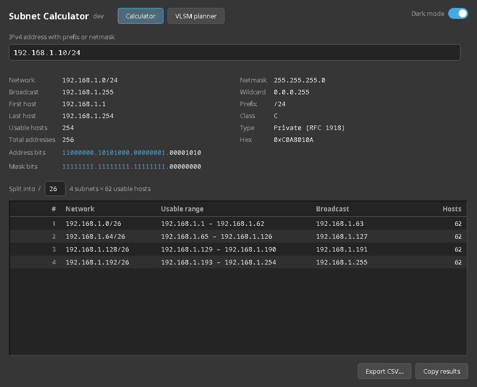
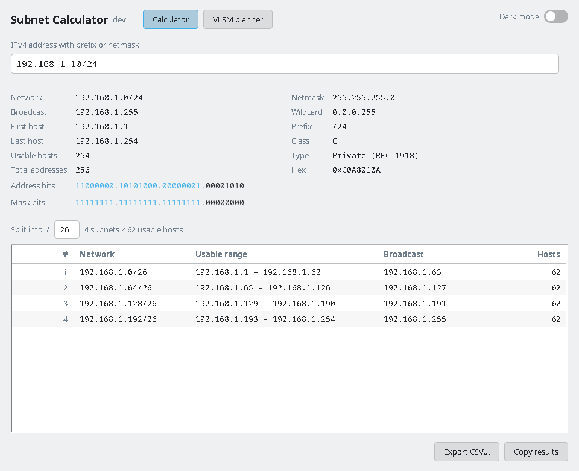
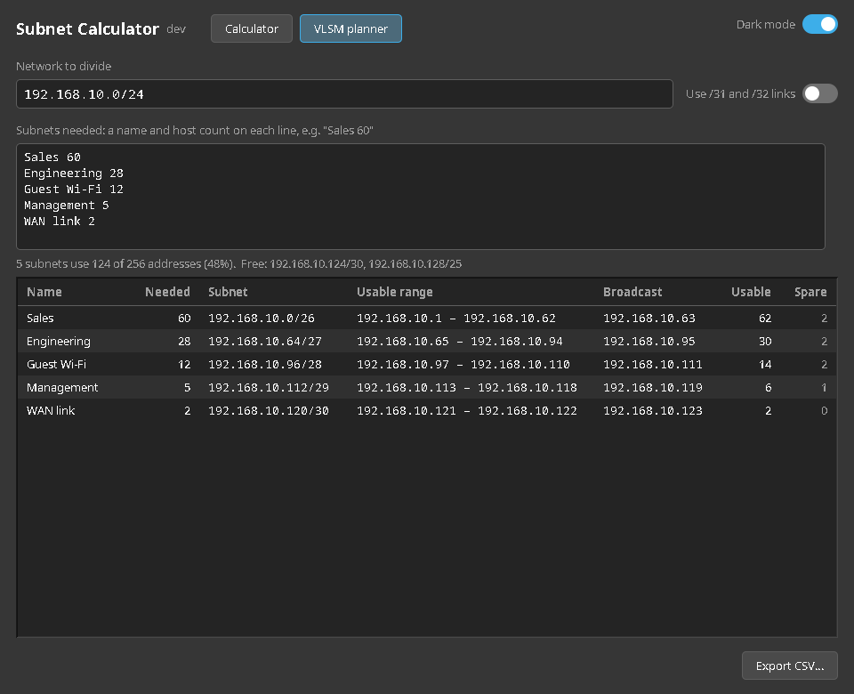

# Subnet Calculator

A fast IPv4 subnet calculator and VLSM planner for the Linux desktop, written in plain Java with
**no dependencies**. It reads your KDE colour scheme and accent colour so it looks at home on Plasma
(Breeze), and has a dark / light mode switch.

| | Dark | Light |
|---|---|---|
| Calculator |  |  |
| VLSM planner |  |  |

Current version: **1.1.0**. See [CHANGELOG.md](CHANGELOG.md) for what changed in each release.

## Features

### Calculator
- Accepts `192.168.1.10/24`, `192.168.1.10/255.255.255.0`, `192.168.1.10 255.255.255.0` or a bare
  address (classful default prefix). Results update as you type.
- Network, broadcast, first/last host, usable and total addresses, netmask, wildcard, class,
  address type (private, CGNAT, loopback, multicast…) and hex.
- Address and mask shown in binary with the network bits highlighted.
- Splits a network into equal subnets. Rows are computed on demand, so large splits use no memory.
- **Copy results** puts a plain-text summary on the clipboard.

### VLSM planner
- Enter a network and the subnets you need, one per line: `Sales 60`, `WAN link: 2`, or just `12`.
  Commas and semicolons also separate entries, so `60, 28, 12` works too.
- Each requirement gets the smallest block that fits. Blocks are placed largest first so the network
  is packed without gaps, and the remaining free space is listed as CIDR blocks.
- Shows each subnet's range, broadcast, usable hosts and spare capacity, and tells you when the
  requirements don't fit.
- Optional **/31 and /32 links**: 2-host needs get a /31 (RFC 3021) and 1-host needs a /32. When it's
  off, both get a /30, the traditional point-to-point allocation.

### Everywhere
- **Export CSV…** saves the subnet table from either page as a spreadsheet-ready CSV file
  (RFC 4180, with separate columns for network, prefix, netmask, first/last host and broadcast).
  It uses KDE's own save dialog when `kdialog` is installed, and writes on a background thread.
- Handles /31 point-to-point links (RFC 3021) and /32 host routes correctly.
- Dark / light switch and the last page you used are remembered between runs. The first launch
  follows the desktop's colour scheme.

## Requirements

- Java 25 JDK. On Fedora: `sudo dnf install java-25-openjdk-devel`

## Build and install

```sh
./build.sh      # compiles, runs the tests, writes build/subnet-calculator.jar
./install.sh    # adds "Subnet Calculator" to the application menu and ~/.local/bin
```

Run it from the menu, with `subnet-calculator`, or straight from the jar with
`java -jar build/subnet-calculator.jar`. Ready-built jars are attached to each
[GitHub release](../../releases).

Remove it with `./install.sh --uninstall`.

## Design notes

- `Subnet` holds the address arithmetic (all on a 32-bit `int`), `Vlsm` the planner, and `Csv` the
  export. `Theme` reads colours from `~/.config/kdeglobals` with Breeze fallbacks. `Ui` is a small
  flat look and feel with the shared widgets, and `CalculatorView` / `VlsmView` are the two pages.
- The jar is a few dozen KB. The launcher uses a small heap, the serial GC and an automatically
  created class-data-sharing archive, so later starts are quicker and memory use stays low.
- Tests are a plain Java class (`test/subnetcalc/SubnetTest.java`) run by `build.sh`, with no test framework.
- The version lives in `VERSION` and is stamped into the jar manifest, which the app shows next to its title.

## License

MIT, see [LICENSE](LICENSE).
