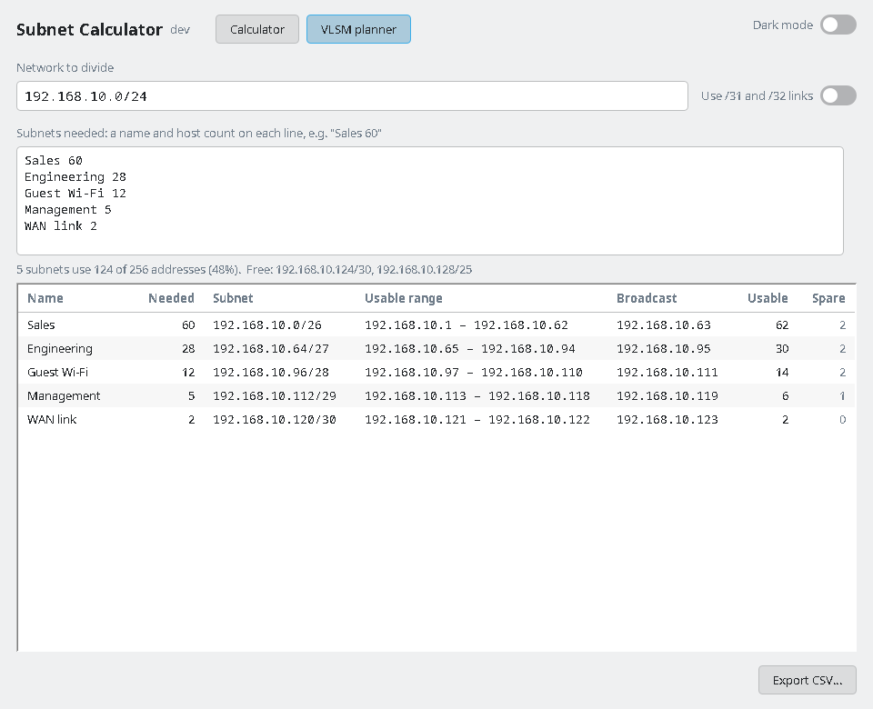
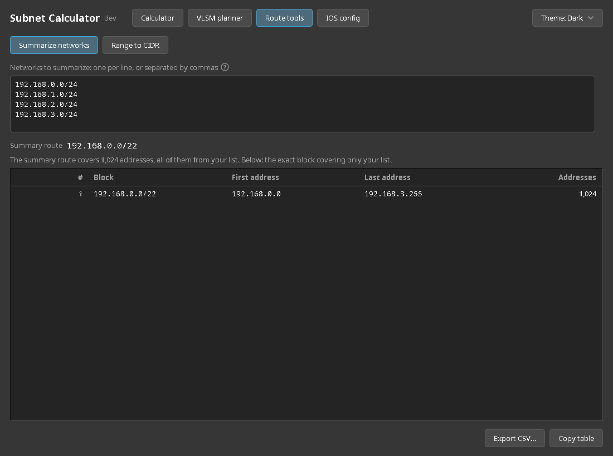
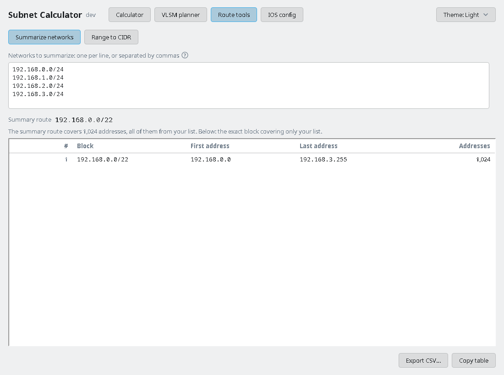
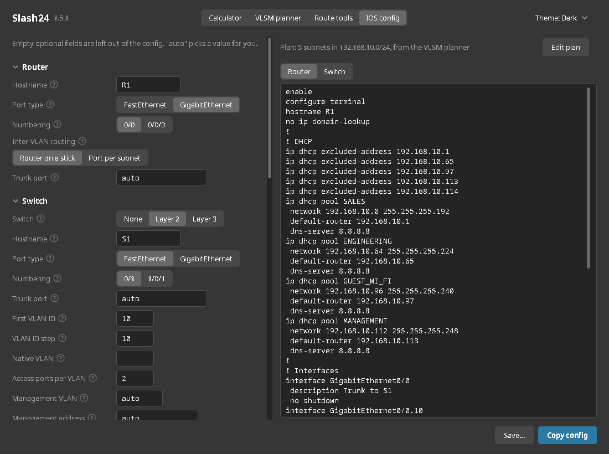
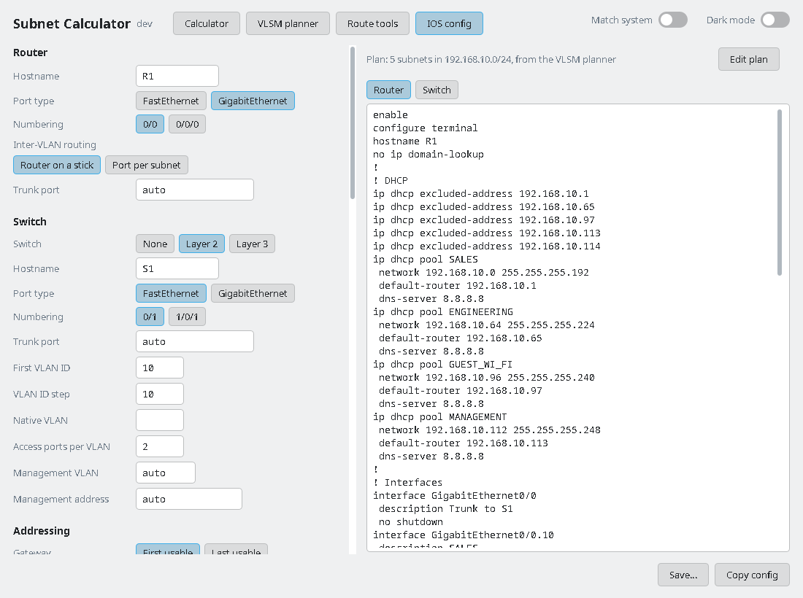

# Slash24

*Called Subnet Calculator before version 1.4.0.*

A fast IPv4 subnet calculator, VLSM planner, route-summarization tool and Cisco IOS config
generator for the Linux desktop,
written in plain Java with **no dependencies**. It reads your KDE colour scheme and accent colour so it looks at home on Plasma
(Breeze), and has a dark / light mode switch.

| | Dark | Light |
|---|---|---|
| Calculator |  |  |
| VLSM planner |  |  |
| Route tools |  |  |
| IOS config |  |  |

Current version: **1.4.1**. See [CHANGELOG.md](CHANGELOG.md) for what changed in each release.

## Features

### Calculator
- Accepts `192.168.1.10/24`, `192.168.1.10/255.255.255.0`, `192.168.1.10 255.255.255.0` or a bare
  address (classful default prefix). Results update as you type.
- Network, broadcast, first/last host, usable and total addresses, netmask, wildcard, class,
  address type (private, CGNAT, loopback, multicast…) and hex.
- Address and mask shown in binary with the network bits highlighted.
- **Contains?** Paste an address to see whether it's in the network, its position (host 77 of 254,
  network or broadcast address), and which split subnet it falls in. That row is highlighted.
- Splits a network into equal subnets. Rows are computed on demand, so large splits use no memory.
- **Copy results** puts a plain-text summary on the clipboard.

### VLSM planner
- Enter a network and the subnets you need, one per line: `Sales 60`, `WAN link: 2`, or just `12`.
  Commas and semicolons also separate entries, so `60, 28, 12` works too.
- Each requirement gets the smallest block that fits. Blocks are placed largest first so the network
  is packed without gaps, and the remaining free space is listed as CIDR blocks.
- Shows each subnet's range, broadcast, usable hosts and spare capacity, and tells you when the
  requirements don't fit.
- Optional **/31 and /32 links**: 2-host needs get a /31 (RFC 3021) and 1-host needs a /32. When it's
  off, both get a /30, the traditional point-to-point allocation.

### Route tools
- **Summarize networks:** paste a list of networks to get the smallest single summary route that
  covers them all, how many extra addresses it takes in, and the exact set of blocks that covers
  only your list (overlaps and neighbours merged).
- **Range to CIDR:** enter a first and last address to get the fewest CIDR blocks that cover exactly
  that range.

### IOS config generator
Turns the plan on the VLSM planner page into router and switch configurations you can paste into
Packet Tracer or a real device. (Review them before using them on production equipment; see the
[disclaimer](#disclaimer).) It updates live as you change the plan or the options, and the
options are remembered. Each settings section can be collapsed. Clearing an optional field leaves
that setting out of the config, and "auto" picks a value for you.
- **Router:** hostname, FastEthernet or GigabitEthernet, `0/0` or `0/0/0` numbering, inter-VLAN
  routing as router on a stick (802.1Q subinterfaces) or a port per subnet, and which port does the
  inter-VLAN work (the trunk, the first LAN port, or the port facing a layer 3 switch).
- **Switch:** none, layer 2 or layer 3, with its own hostname, port type and `0/1` or `1/0/1`
  numbering. A layer 2 switch gets VLANs, access ports, the trunk and (unless you clear it) a
  management VLAN interface with a default gateway. A layer 3 switch routes the VLANs itself (SVIs, `ip routing`) and connects
  to the router over a 2-host subnet in the plan.
- **Addressing:** gateway on the first or last usable address; subnets with 1–2 hosts can become
  point-to-point links on the next free port or a named interface such as `Serial0/1/0`.
- **VLANs:** first ID and step, native VLAN, access ports per VLAN and the trunk / uplink port.
- **DHCP:** a pool per LAN with the gateway excluded, plus DNS server, domain name and a number of
  addresses kept free for static devices.
- **Routing:** OSPF with wildcard-mask network statements, process ID, area, router ID, passive LAN
  interfaces and `default-information originate`; or static routes when OSPF is off; plus your own
  extra static routes.
- **Internet uplink and NAT:** static or DHCP address with a default route; NAT off, PAT on the
  uplink, or an address pool (with or without overload); static NAT and port forwards.
- **Security and remote access, per device:** enable secret, console password, Telnet / SSH / both
  (SSH adds a username and password, which IOS needs for SSH logins, plus the domain name, RSA key
  size and `ip ssh version 2`), VTY lines 0–4 or 0–15, idle timeout, `service password-encryption`
  and a MOTD banner. Passwords are never saved to disk.
- **Output:** optional `enable` / `configure terminal` … `write memory` wrapper, lab extras
  (`no ip domain-lookup`, `logging synchronous`) and section comments. Copy or save each device's config.

### Everywhere
- **Copy table** puts any table on the clipboard as tab-separated text, which pastes straight into
  spreadsheet cells (up to 100,000 rows; use Export CSV for more).
- **Export CSV…** saves the table from any page as a spreadsheet-ready CSV file
  (RFC 4180, with separate columns for network, prefix, netmask, first/last host and broadcast).
  It uses KDE's own save dialog when `kdialog` is installed, and writes on a background thread.
- Handles /31 point-to-point links (RFC 3021) and /32 host routes correctly.
- **Theme** dropdown: *Match system* follows the Plasma colour scheme and accent colour live,
  including changes made while the app is open; or pick *Light* or *Dark*. The choice is remembered.
- **Help on every setting:** hover the **?** next to a setting for a short description and an example.
- **Recent** (or the Down arrow) on the network fields lists the last 10 networks you used.
- Errors wait until you pause typing, so half-typed input like `192.168.` isn't flagged straight away.

### Keyboard shortcuts

| Keys | Action |
|---|---|
| Ctrl+L | Jump to the page's main input |
| Ctrl+Shift+C | Copy results (Calculator), the table (VLSM, Route tools) or the config (IOS config) |
| Ctrl+D | Toggle dark / light (switches the theme off Match system) |
| Ctrl+1 / 2 / 3 / 4 | Calculator / VLSM planner / Route tools / IOS config |
| Down arrow | Recent networks, in a network field |

## Install

Download from the latest [GitHub release](../../releases). Everything includes its own Java runtime.

**Windows:** run `Slash24-<version>-windows-x64.msi` (Start menu entry, optional desktop shortcut,
upgrades in place), or unzip `Slash24-<version>-windows-x64.zip` anywhere and run `Slash24.exe`.

**Linux:** put the Linux files in one folder and run:

```sh
./install.sh              # Fedora/RHEL family: system-wide RPM; any other Linux: just for you
./install.sh --user       # just for you, no password needed
./install.sh --uninstall
```

The Linux packages need 64-bit Linux; `INSTALL.txt` lists the minimum glibc for that release.

## Build from source

Needs a Java 25 JDK. On Fedora: `sudo dnf install java-25-openjdk-devel`

```sh
./build.sh      # compiles, runs the tests, writes build/slash24.jar
./install.sh    # developer install for the current user, using the system Java
./package.sh    # Linux installers into dist/ (also needs java-25-openjdk-jmods and rpm-build)
./package-windows.sh  # Windows .msi and .zip (on Windows, in Git Bash, with the WiX Toolset)
```

GitHub Actions (`.github/workflows/build.yml`) builds and tests both platforms on every push, and
publishes the installers when a version tag such as `v1.4.1` is pushed.

`./install.sh --uninstall` removes the developer install.

## Design notes

- `Subnet` holds the address arithmetic (all on a 32-bit `int`), `Vlsm` the planner, `Cidr` range
  splitting and summarization, `IosConfig` the Cisco config generator, and `Csv` the export. `Theme` reads colours from `~/.config/kdeglobals`
  with Breeze fallbacks and watches it with inotify for live changes. `Ui` is a small flat look and
  feel with the shared widgets, `History` the recent-networks list, and `CalculatorView`, `VlsmView`,
  `ToolsView` and `ConfigView` are the four pages.
- Pages are built the first time they are opened, and the config form only re-lays itself out when
  a row actually appears or disappears.
- Startup: the build records which classes a launch loads (`tools/slash24/Training.java`, run
  headless) and installing turns that list into a class-data-sharing archive in a separate short
  Java run. With it the window opens about a third faster. The launcher also uses a small heap, the
  serial GC and a quick-start JIT, so memory use stays low.
- Packaging: `jlink` builds a runtime with only the three modules the app uses (about 59 MB); the
  RPM installs it under `/opt` without exposing its private libraries as dependencies.
- Tests are a plain Java class (`test/slash24/SubnetTest.java`) run by `build.sh`, with no test framework.
- The version lives in `VERSION` and is stamped into the jar manifest, which the app shows next to its title.

## License

MIT, see [LICENSE](LICENSE).

## Disclaimer

Slash24 is not affiliated with or endorsed by Cisco Systems. Cisco and IOS are trademarks of Cisco
Systems, Inc. Review generated configurations before using them on production equipment.
